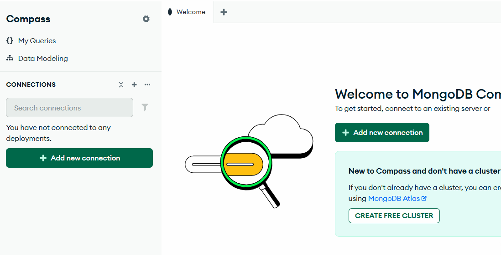
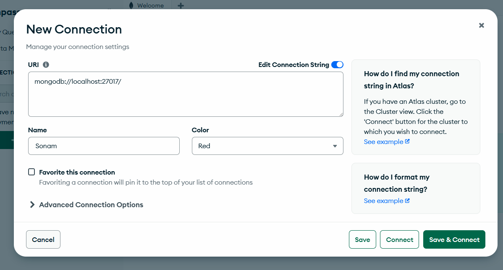
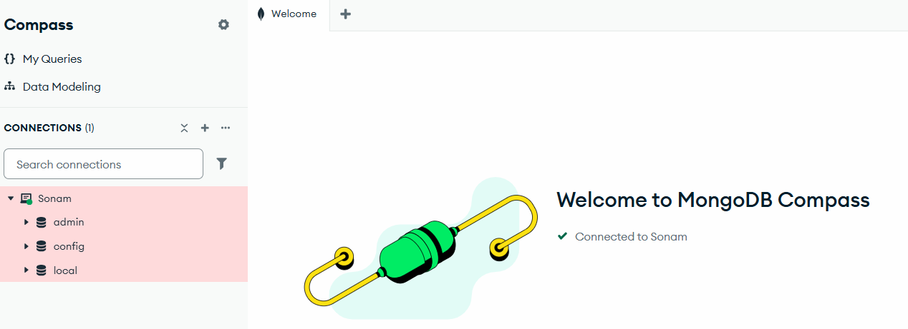
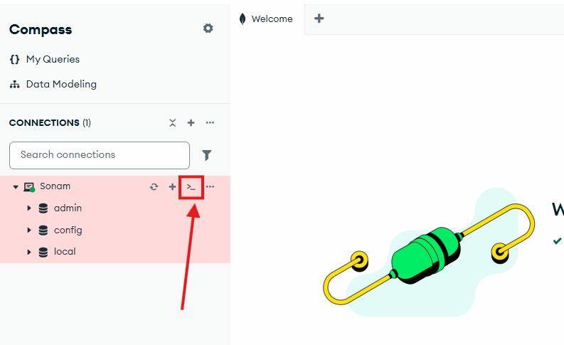
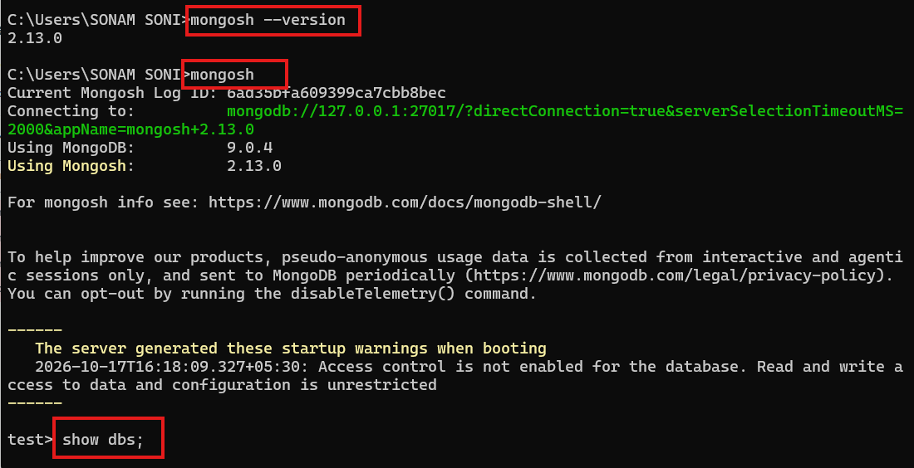

# Install MongoDB

- install mongoDB community Server
[Download MongoDB](https://www.mongodb.com/try/download/community)

- double click and install
- next, accept terms
- select complete
- next and continue installation
- automatically once it is installed, it will install MongoDB compass too.

- once mongoDB compass installed you will get below screen.





- click on save and connect



- you can see default DBs

## Open MongoDB Shell



- If you don't want this shell then you can install mongoDB shell

[Download MongoDB Shell](https://www.mongodb.com/try/download/shell)

- install with default configuration.

- once installed open cmd and execute below commands.



- Now Let's create Database

```sh

show dbs; # to see available databases

use pwskills; # for creating Database

db.createCollection("students"); # create Collection

show collections; # to see available connections
# Insertion
db.students.insertOne(
    { 
        name:"Sonam Soni",
        age:40, 
        course:"MERN Stack",
        marks:90
    });

# Selection
db.students.find()

## Insert Many
db.students.insertMany([
    { 
        name:"Bhaskar",
        age:23, 
        course:"JAVA",
        marks:85
    },
    { 
        name:"Abhishek",
        age:24, 
        course:"C++",
        marks:78
    },
    { 
        name:"Sharavani",
        age:21, 
        course:"Agentic AI",
        marks:89
    }
]);

db.students.find();
```

## Task to complete

- [Create MongoDB Atlas Account](https://www.mongodb.com/products/platform/atlas-database)

- once its cretaed leave it black, configuration we will do later.


## Query Task

- create database of your name
- cretae collection named employees
- insert some records of employees.
- retrive all records from employee collection