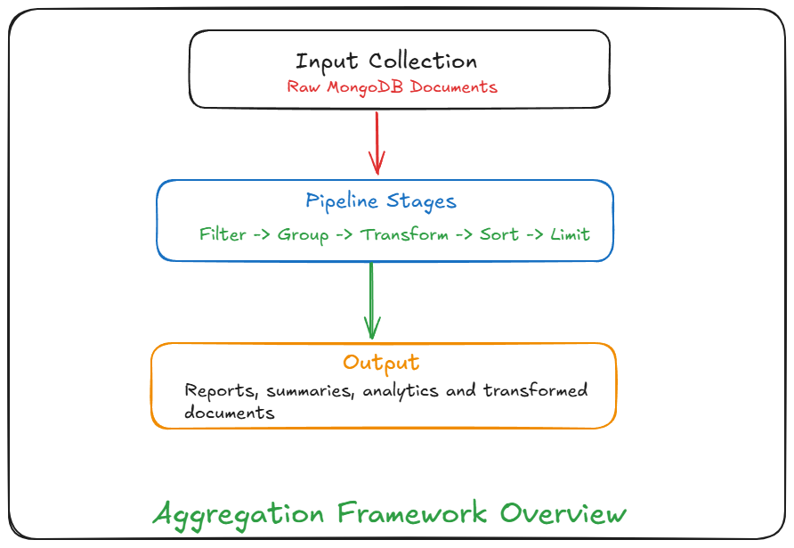
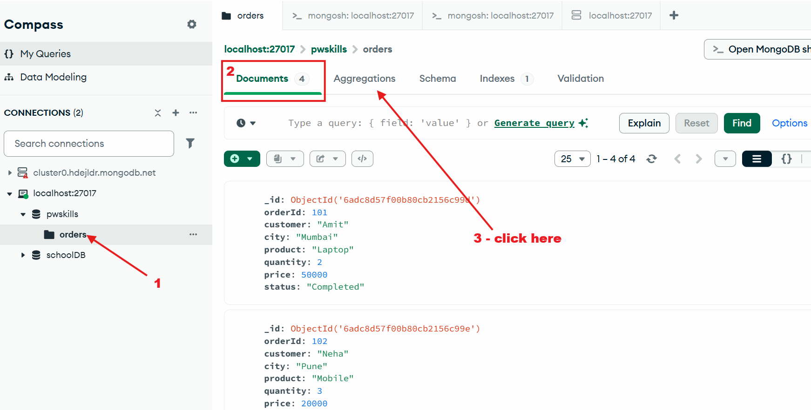
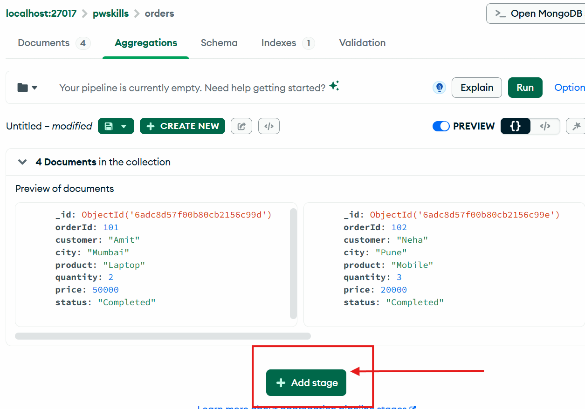
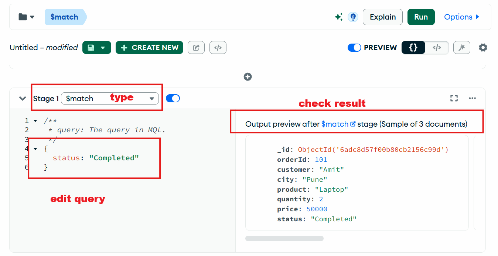
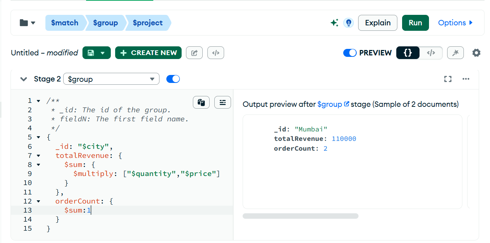
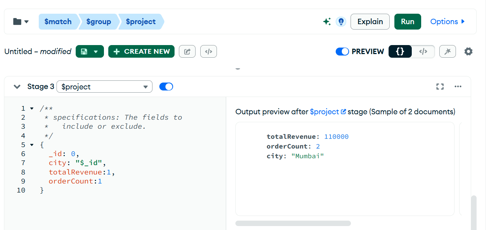
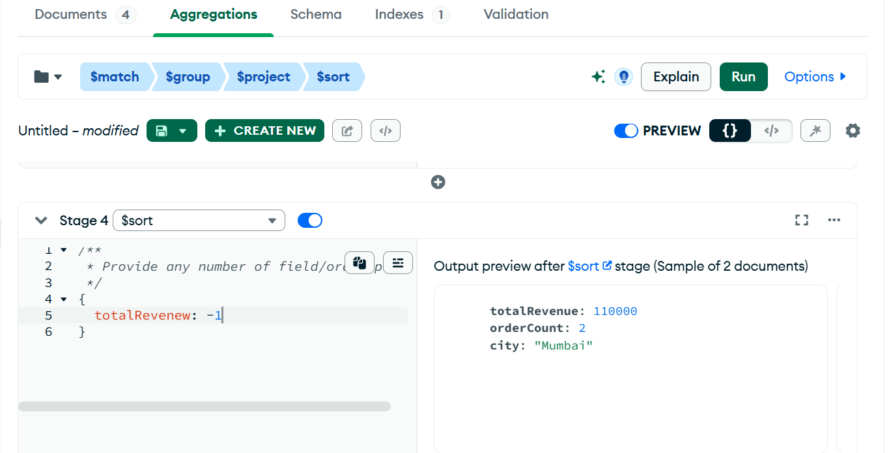
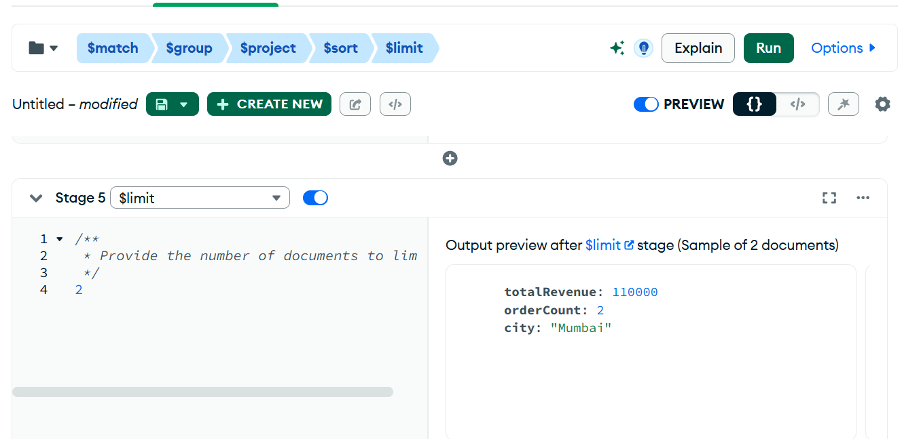
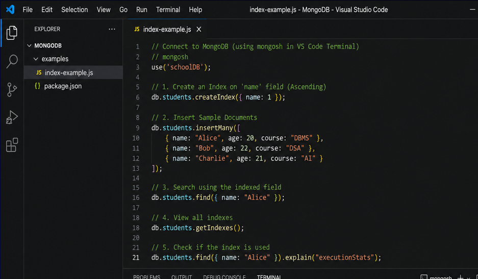

# Aggregation Framework Overview



## $Match Operator

```javascript

use pwskills;

// if you insert directly It will create collection if not available
db.orders.insertMany([
  {
    orderId: 101,
    customer: "Amit",
    city: "Mumbai",
    product: "Laptop",
    quantity: 2,
    price: 50000,
    status: "Completed"
  },
  {
    orderId: 102,
    customer: "Neha",
    city: "Pune",
    product: "Mobile",
    quantity: 3,
    price: 20000,
    status: "Completed"
  },
  {
    orderId: 103,
    customer: "Amit",
    city: "Mumbai",
    product: "Mouse",
    quantity: 5,
    price: 500,
    status: "Pending"
  },
  {
    orderId: 104,
    customer: "Raj",
    city: "Pune",
    product: "Laptop",
    quantity: 1,
    price: 50000,
    status: "Completed"
  }
]);
```

**$match filter documents**
- similar to where in SQL

```javascript
db.orders.aggregate([
  {
    $match: {
      status: "Completed"
    }
  }
])

// With Projection
db.orders.aggregate([
  {
    $match: {
      status: "Completed"
    }
  },
  {
    $project: {
        _id:0,
        customer:1,
        product:1,
        status:1
    }
  }
])
```

**$project - is used to select the fields and transform them**

```javascript
db.orders.aggregate([
  {
    $project: {
        _id:0,
        customer:1,
        product:1,
        totalAmount: {
            $multiply: ["$quantity","$price"]
        }
    }
  }
])
```

**$sort and $limit**

```javascript
db.orders.aggregate([
  {
    $project: {
        _id:0,
        customer:1,
        product:1,
        totalAmount: {
            $multiply: ["$quantity","$price"]
        }
    }
  },
  { $sort: { totalAmount: -1 } },
  { $limit: 3}
])
```

**$group**

```javascript
//  update records

db.orders.updateMany({},{$set: {city: "Mumbai"}})
db.orders.updateMany({customer: "Amit"},{$set: {city: "Pune"}})


db.orders.aggregate([
  {
    $project: {
        _id:0,
        customer:1,
        product:1,
        city:1,
        totalAmount: {
            $multiply: ["$quantity","$price"]
        }
    }
  },
  { 
    $group: {
        _id: "$city",
        totalSales: { $sum: "$totalAmount" }
    }
  }
])
```

1. Write a query to count order per city.
2. Calculate Average Sales per city
3. find minimum and Maximum sales


```js
db.orders.aggregate([
  {
    $group: {
      _id: "$city",
      orderCount: { $sum: 1 }
    }
  }
])

db.orders.aggregate([
  {
    $project: {
        _id:0,
        customer:1,
        product:1,
        city:1,
        totalAmount: {
            $multiply: ["$quantity","$price"]
        }
    }
  },
  { 
    $group: {
        _id: "$city",
        averageSales: { $avg: "$totalAmount" }
    }
  }
])

db.orders.aggregate([
  {
    $project: {
        _id:0,
        customer:1,
        product:1,
        city:1,
        totalAmount: {
            $multiply: ["$quantity","$price"]
        }
    }
  },
  { 
    $group: {
        _id: "$city",
        minSales: { $min: "$totalAmount" },
        maxSales: { $max: "$totalAmount" },
    }
  }
])
```

**$count**

```js
db.orders.aggregate([
  { $match: { status: "Completed" } },
  { $count: "totalCompletedOrders" }
]);
```

**concat**

```js
db.orders.aggregate([
  {
    $project:{
      _id:0,
      customerDetails:{$concat:["$customer"," - ","$city"]},
       greeting: {
        $concat: ["Hello, ", "$customer", "! Your order for ", "$product", " is ", "$status", "."]
      }
    }
  }
]);
```

## $sort and $limit

```js
use('schoolDB');

db.students.insertMany([
  {name:"Alice",marks:91,age:20},
  {name:"Bob",marks:78,age:21},
  {name:"Charlie",marks:95,age:19},
  {name:"David",marks:85,age:20},
  {name:"Emma",marks:88,age:22},
  {name:"Frank",marks:72,age:21}
]);

db.students.aggregate([
  {$sort:{marks:-1}},
  {$limit:3}
]);

db.students.aggregate([
  {$project: {_id:0}},
  {$sort:{marks:-1}},
  {$limit:3}
]);
```

## MongoDB Compass Aggregation Builder

- In MongoDB Compass







- again click on Add Stage









- Run query see the output, save the pipeline
- also you can see the query code.


## Practice Task for Indexing



