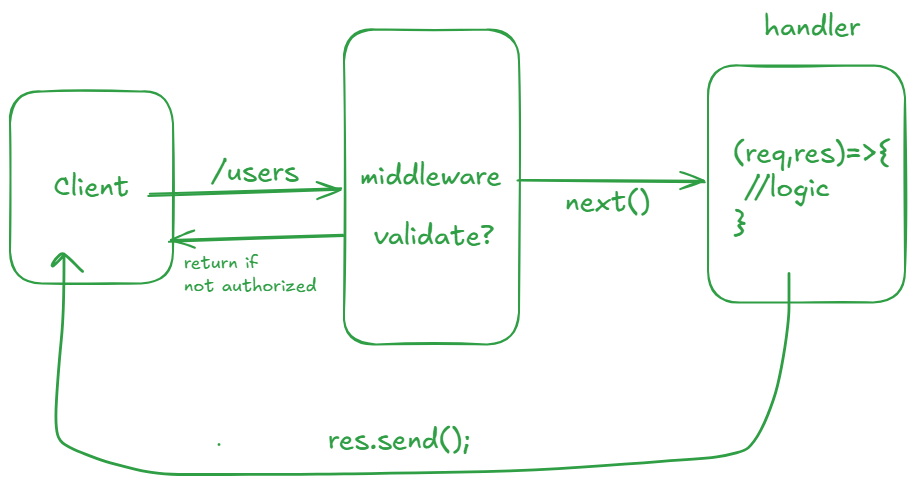

# Create Express Server

- Open VS Code
- Create one folder named express-demo
- open terminal in VS Code

```bash
cd express-demo

# Creating Package.json
npm init -y

# install Express
npm install express
```

- Create file server.js
- create .gitignore file
- create routing.js file
- to run any file: node server.js

## Middlware



- create in existing code

```js
// middleware
app.use((req,res,next)=>{
    console.log(req.method);
    next();
})
```
- make sure to stop existing server and run again after save your code.
- trigger all request and see in console before all request middleware is triggered.


## Practice Task

- Create one Express Project
- setup routing for Product Management
- create below routes:
  -  Get All Products
  -  Get Product By ID
  -  Create New Product
  -  Update Existing Product
  -  Delete Existing Product
-  Create Middlewares
   - Logger Middleware
   - Error handler Middleware

*Backend Logic we will write letter just setup project with dummy response*