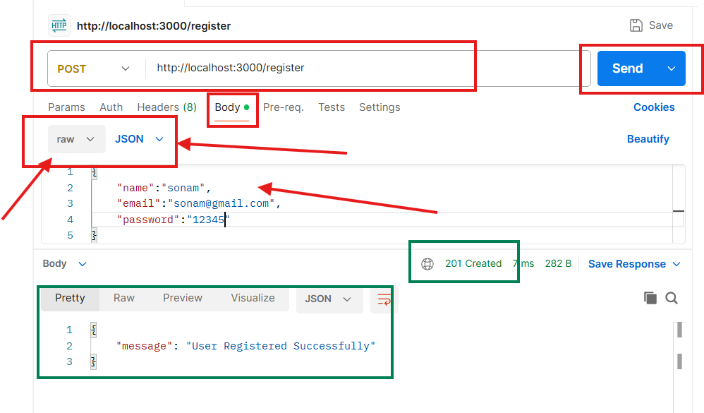
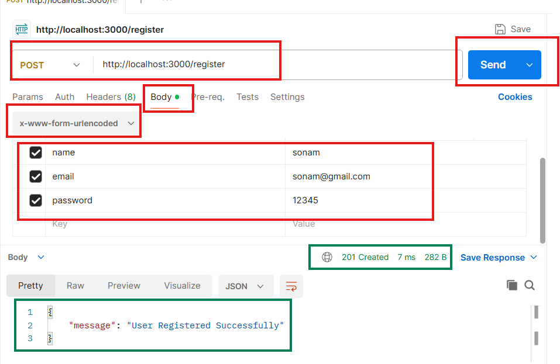
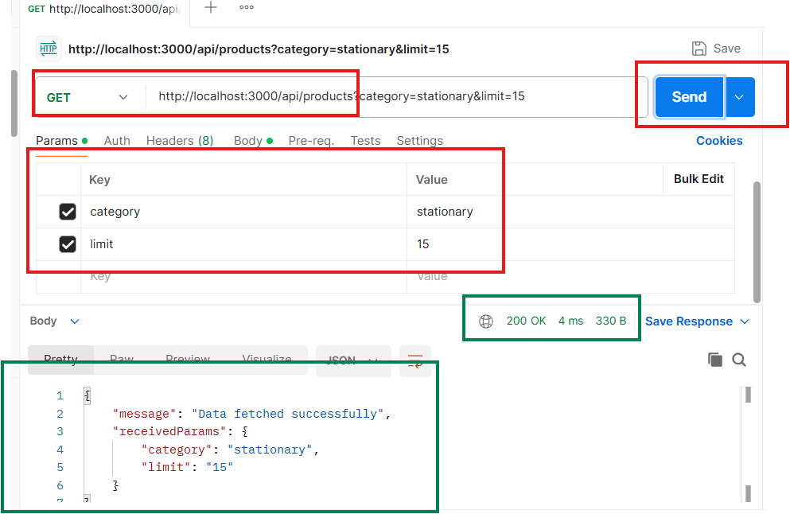

# Access API

- create demo.js
- just for learning concept
- create file and run temporary: node demo.js
  

## REST API

- create new file server.js
- to restart server automatically use nodemon
- npm i nodemon
- change pckage.json: "dev" : "nodemon server.js"
- and then to run just use: npm run dev
- now everytime when you change your code you server restarts automatically.

## Query Params

- http://localhost:3000/api/products
- http://localhost:3000/api/products?category=electronics&limit=20
-  you can also test with URL and type params using Postman
-  

## Swagger Setup

- npm i swagger-ui-express swagger-jsdoc

- now create swagger.js file at the same level where server.js available
- update server.js file with documentation