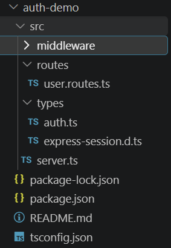

```bash
mkdir auth-demo
cd auth-demo
npm install express express-session
npm install -D typescript tsx  @types/node @types/express @types/express-session

npx tsc --init
```

- folder structure



- add code as shown
- start server: npm run dev

- check APIs using POSTMAN / thunderclient
- localhost:5000/api/login (POST method)
- credentials in JSON: 

```json
{
  "username":"admin",
  "password":"admin123"
}
```

- check Response
- also try: localhost:5000/api/admin (GET method)
- you can see you have full access
- try again login with user credentials
- also try: localhost:5000/api/admin (GET method) - you can see error
- localhost:5000/api/user (GET method) - you have access

- localhost:5000/api/public (access from ANYWHERE)
- it is having all access.